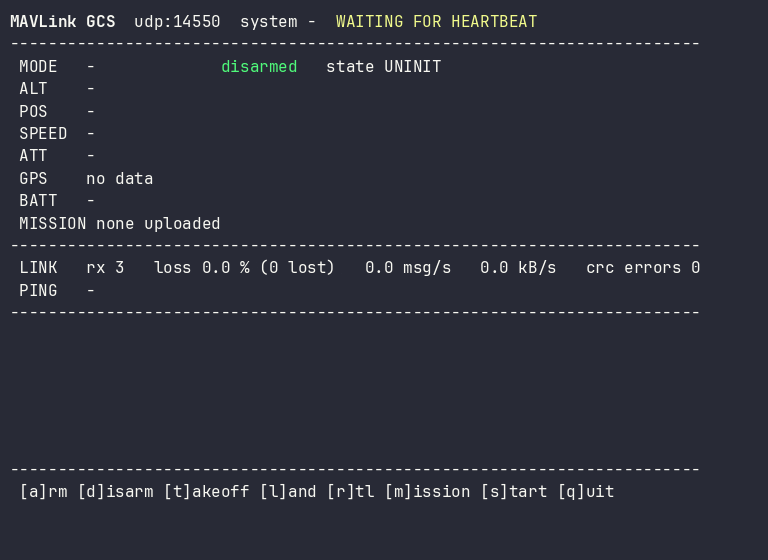

# mavlink-ground-station



Lightweight MAVLink v2 ground control station in C++17 with zero dependencies: live telemetry, link-quality stats, arm/takeoff/RTL, mission upload, recording and replay, plus a built-in vehicle simulator so everything runs without hardware.

[](https://github.com/bekirhankarakurt/mavlink-ground-station/actions/workflows/ci.yml)
[](https://github.com/bekirhankarakurt/mavlink-ground-station/actions/workflows/codeql.yml)
[](https://bekirhankarakurt.github.io/mavlink-ground-station/coverage/)
[](https://github.com/bekirhankarakurt/mavlink-ground-station/releases/latest)
[](LICENSE)
[](https://en.cppreference.com/w/cpp/17)
[](https://github.com/bekirhankarakurt/mavlink-ground-station#requirements)

**Documentation:** [API reference and coverage report](https://bekirhankarakurt.github.io/mavlink-ground-station/) | [Releases](https://github.com/bekirhankarakurt/mavlink-ground-station/releases) | [Changelog](CHANGELOG.md)

## Why / what

- **Own protocol stack, no MAVLink library.** Frame parser/serializer, X.25 CRC and `CRC_EXTRA` validation for the whole common dialect (generated table), typed codecs for the 15 messages a GCS needs. Golden frames are cross-checked against `pymavlink`.
- **Operational, not a demo.** Arm, disarm, takeoff, land, RTL, mission start with ACK tracking and retries; mission upload (`MISSION_COUNT` / `REQUEST_INT` / `ITEM_INT` / `ACK`) from a plain-text file with timeout and retry.
- **Link quality you can trust.** Loss from sequence gaps (per source, wrap-safe), message/byte rates, CRC errors and ping round-trip latency.
- **Record and replay.** QGC/Mission Planner-compatible `.tlog` files; replay drives the same dashboard at any speed.
- **Testable without a drone.** `mavsim` is a small kinematic multicopter that speaks PX4-style MAVLink (modes, mission execution, battery, configurable packet loss). The whole stack, including UDP end-to-end, runs in CI.

## Demo

`mavsim` flying `examples/mission_square.txt` over a link with 2 % injected loss, dashboard captured mid-flight (`mavgcs --ui dashboard`):

```text
MAVLink GCS  udp:14550  system 1  LINK OK
------------------------------------------------------------------------
 MODE   AUTO.MISSION  ARMED   state ACTIVE
 ALT       20.0 m rel     508.0 m MSL     HDG 180
 POS     47.3982562    8.5455940
 SPEED  gs   8.0 m/s   climb  +0.0 m/s   throttle  45 %
 ATT    roll   +0.0   pitch   +0.0   yaw  -180.0 deg
 GPS    3D  sats 12  hdop 0.80
 BATT   16.70 V  10.5 A  97 %
 MISSION 6 items on vehicle   current wp 4
------------------------------------------------------------------------
 LINK   rx 337   loss 3.2 % (11 lost)   26.9 msg/s   1.0 kB/s   crc errors 0
 PING   last 0.2 ms   avg 0.2 ms   min 0.2   max 0.4
------------------------------------------------------------------------
 [    0.7s] MISSION_START: ACCEPTED
 [    0.7s] vehicle: Mission started
 [    1.7s] vehicle armed
 [    4.6s] vehicle: Reached waypoint 1
 [    8.7s] vehicle: Reached waypoint 2
 [   11.2s] vehicle: Reached waypoint 3
------------------------------------------------------------------------
 [a]rm [d]isarm [t]akeoff [l]and [r]tl [m]ission [s]tart [q]uit

```

Log-style output (`--ui log`) for scripts and CI:

```text
[    0.7s] ARM sent
[    0.7s] ARM/DISARM: ACCEPTED
[    0.7s] vehicle: Armed
[    0.7s] TAKEOFF sent
[    0.7s] TAKEOFF: ACCEPTED
[    0.7s] vehicle: Takeoff to 15 m
[    1.4s] vehicle: Takeoff complete, holding
[    6.7s] RTL: ACCEPTED
[    8.2s] vehicle: Landed, disarmed
summary: 228 frames, 0.0% loss, 0 crc errors
```

## Quick start (60 seconds)

```bash
cmake -S . -B build && cmake --build build --parallel && ctest --test-dir build --output-on-failure
```

```bash
./build/mavsim --speed 4 &
```

```bash
./build/mavgcs --mission examples/mission_square.txt
```

In the dashboard press `m` (upload), `a` (arm), `s` (start mission), `q` (quit). Without a terminal, use `--ui log` and `--script` (see recipes).

## Requirements

| Item | Version | Notes |
|---|---|---|
| Compiler | any C++17 compiler (tested: GCC 13, Clang 18) | built with `-Wall -Wextra -Wpedantic -Wshadow -Wconversion`, zero warnings |
| CMake | 3.16+ | |
| OS | Linux | POSIX sockets/termios; macOS should work but is not covered by CI |
| Libraries | none | standard library only; tests need no framework |
| Bash | any | only for the `e2e_udp` CTest |

### Build options

| Option | Default | Effect |
|---|---|---|
| `CMAKE_BUILD_TYPE` | `Release` | standard CMake build type |
| `MAVGS_BUILD_TESTS` | `ON` | build unit tests and the UDP end-to-end test |
| `MAVGS_BUILD_APPS` | `ON` | build `mavgcs` and `mavsim` |
| `MAVGS_WERROR` | `OFF` | treat warnings as errors (CI turns this on) |
| `MAVGS_SANITIZE` | `OFF` | AddressSanitizer + UBSan |

## Usage

### `mavgcs` - ground station

| Option | Default | Description |
|---|---|---|
| `--port N` | `14550` | UDP port to listen on |
| `--connect HOST:PORT` | - | initial destination until the vehicle has been heard (IPv4) |
| `--replay FILE` | - | replay a `.tlog` instead of opening a link |
| `--speed X` | `1` | replay speed multiplier |
| `--record FILE` | - | record received frames to a `.tlog` |
| `--mission FILE` | - | waypoint file used by the `m` key |
| `--takeoff-alt M` | `10` | altitude for the `t` key, metres above ground |
| `--script STEPS` | - | run steps then exit; see below |
| `--ui dashboard\|log` | dashboard on a TTY, else log | output style |
| `--duration S` | until quit | exit after S seconds |
| `--sysid N` / `--vehicle N` | `255` / first autopilot heard | own id / vehicle to track |
| `--no-color` | - | disable ANSI colors (also honours `NO_COLOR`) |

Keys (dashboard): `a` arm, `d` disarm, `t` takeoff, `l` land, `r` RTL, `m` upload mission, `s` start mission, `q` quit.

Script steps (comma separated): `arm`, `disarm`, `takeoff:ALT`, `land`, `rtl`, `start`, `mission:FILE`, `wait:SECONDS`, `wait-disarmed`. Each command step waits for the vehicle's ACK; a rejection or timeout aborts with exit code 1. Exit codes: `0` ok, `1` script failed, `2` bad arguments.

### `mavsim` - vehicle simulator

| Option | Default | Description |
|---|---|---|
| `--target HOST:PORT` | `127.0.0.1:14550` | where to stream telemetry |
| `--port N` | `14580` | local UDP port |
| `--speed X` | `1` | simulation speed multiplier |
| `--loss P` | `0` | probability (0..1) of dropping each outgoing frame |
| `--seed N` | `1` | seed of the deterministic loss model |
| `--sysid N` | `1` | MAVLink system id |
| `--home LAT,LON,ALT` | PX4 SITL home | home position (deg, m AMSL) |
| `--duration S` | until interrupted | exit after S seconds |

### Recipes

**1. Fly a mission unattended (CI-friendly)**

```bash
./build/mavsim --speed 8 --duration 60 &
./build/mavgcs --ui log --script "mission:examples/mission_square.txt,arm,start,wait-disarmed"
```

**2. Quick hop: takeoff, hold, return**

```bash
./build/mavsim --speed 8 --duration 40 &
./build/mavgcs --ui log --script "arm,takeoff:15,wait:6,rtl,wait-disarmed"
```

**3. Stress the link with 10 % packet loss**

```bash
./build/mavsim --loss 0.1 --seed 5 --duration 14 &
./build/mavgcs --ui log --duration 12
```

The summary reports about 11 % loss (measured from sequence gaps, not from the injected figure).

**4. Record a flight and replay it faster**

```bash
./build/mavsim --speed 8 --duration 40 &
./build/mavgcs --ui log --record flight.tlog --script "mission:examples/mission_square.txt,arm,start,wait-disarmed"
./build/mavgcs --replay flight.tlog --speed 5
```

Commands are disabled during replay. The same file opens in QGroundControl/Mission Planner.

**5. PX4 SITL**

```bash
make px4_sitl gz_x500      # in the PX4-Autopilot checkout
./build/mavgcs --mission examples/mission_square.txt
```

PX4 SITL streams to UDP 14550 by default, which is where `mavgcs` listens, and replies go to the port PX4 sends from. Takeoff altitude is sent as AMSL derived from telemetry. The waypoints in `mission_square.txt` are around PX4's default Zurich home. This path follows the standard GCS profile but is **not exercised by CI or by the author's tests**; the simulator is the tested target. For ArduPilot SITL use `sim_vehicle.py --out=udp:127.0.0.1:14550`.

## Architecture

```text
                +-------------------------------- mavgcs --------------------------------+
 keyboard ----> |  ScriptRunner / key handler                                             |
                |        |                                                                |
 UDP :14550 <-> |  Link (UdpLink | ReplayLink) <-> Station <-> VehicleState / LinkStats    | --> dashboard / log
 .tlog  ------> |                  |    |            |                                    | --> .tlog (record)
                |                  |    +-> MissionUploader   +-> command tracker (retry)  |
                |                Parser / Packer (CRC_EXTRA) + typed Message variant      |
                +-------------------------------------------------------------------------+
                                   ^ UDP
                                   |
                +------------------+-- mavsim ---------------------------------------------+
                |  VehicleSim: telemetry streams, commands, mission protocol, flight model |
                +--------------------------------------------------------------------------+
```

Design trade-offs:

- **Single-threaded poll loop.** `Station::service(now, wait)` takes caller-supplied time, so the whole stack (including retries and timeouts) is deterministic under test. No locks, no data races; the price is that a slow renderer delays packet processing (rendering is capped at 5 Hz).
- **Typed `std::variant` messages** instead of generated code: 15 hand-written codecs are easy to audit; new messages cost about 20 lines each. Wire order and `CRC_EXTRA` are verified against `pymavlink` golden frames.
- **Full common-dialect `CRC_EXTRA` table** (generated by `tools/gen_crc_extra.py`) so corrupt frames of messages we do not decode are still rejected and sequence-gap loss accounting stays correct. Unknown ids outside the dialect pass through unverified.
- **Signatures are skipped, not verified.** Signed links parse correctly but are not authenticated.
- **UDP/IPv4 only.** Matches PX4/ArduPilot SITL and typical telemetry radios bridged to UDP; serial and TCP are out of scope.
- **Simulator is kinematic, not dynamic.** It exercises protocol behavior (modes, ACKs, mission flow, loss) rather than aerodynamics.

## Protocol and file formats

### Supported messages

| Id | Message | Direction | CRC_EXTRA |
|---|---|---|---|
| 0 | HEARTBEAT | both | 50 |
| 1 | SYS_STATUS | vehicle -> GCS | 124 |
| 4 | PING | both (latency) | 237 |
| 24 | GPS_RAW_INT | vehicle -> GCS | 24 |
| 30 | ATTITUDE | vehicle -> GCS | 39 |
| 33 | GLOBAL_POSITION_INT | vehicle -> GCS | 104 |
| 40 / 51 | MISSION_REQUEST / MISSION_REQUEST_INT | vehicle -> GCS | 230 / 196 |
| 42 | MISSION_CURRENT | vehicle -> GCS | 28 |
| 44 | MISSION_COUNT | GCS -> vehicle | 221 |
| 47 | MISSION_ACK | vehicle -> GCS | 153 |
| 73 | MISSION_ITEM_INT | GCS -> vehicle | 38 |
| 74 | VFR_HUD | vehicle -> GCS | 20 |
| 76 | COMMAND_LONG | GCS -> vehicle | 152 |
| 77 | COMMAND_ACK | vehicle -> GCS | 143 |
| 253 | STATUSTEXT | vehicle -> GCS | 83 |

Commands sent: `MAV_CMD_COMPONENT_ARM_DISARM` (400), `NAV_TAKEOFF` (22), `NAV_LAND` (21), `NAV_RETURN_TO_LAUNCH` (20), `MISSION_START` (300). Unanswered commands are resent twice (1.5 s apart, `confirmation` incremented) before reporting "no response".

### Mission file

Plain text, one item per line, `#` starts a comment, keywords are case-insensitive. Altitudes are metres above home; errors are reported with line numbers. Items are uploaded as `MISSION_ITEM_INT` in `MAV_FRAME_GLOBAL_RELATIVE_ALT_INT` (`rtl` uses `MAV_FRAME_MISSION`), maximum 700 items.

| Line | MAV_CMD | Notes |
|---|---|---|
| `takeoff ALT` | 22 | climbs at the current position |
| `waypoint LAT LON ALT [HOLD_S]` | 16 | `HOLD_S` is param1 |
| `land [LAT LON]` | 21 | no coordinates = land in place |
| `rtl` | 20 | |

### Telemetry log (`.tlog`)

| Offset | Size | Content |
|---|---|---|
| 0 | 8 | timestamp, microseconds since Unix epoch, big-endian |
| 8 | 12 + len (+13 if signed) | raw MAVLink v2 frame |

Records repeat back to back; a truncated tail is ignored on read.

## Testing

```bash
ctest --test-dir build --output-on-failure
```

| Test | Covers |
|---|---|
| `test_frame` | CRC check value, golden frames from pymavlink (parse + serialize), resync after corruption, split input, signatures, truncation |
| `test_messages` | round-trip of every message, zero-fill of truncated payloads |
| `test_mission` | file parser errors with line numbers, upload handshake, retries, timeouts |
| `test_stats_tlog_link` | loss across sequence wrap, rates, latency, tlog layout, real UDP sockets, replay timing |
| `test_sim` | telemetry streams, arming rules, takeoff, land, RTL, mission flight, loss model, determinism |
| `test_station` | vehicle tracking, ACK/retry/timeout, link lost/restored, record-then-replay, dashboard rendering |
| `test_cli_script` | option parsing, script parsing and execution against the simulator |
| `e2e_udp` | `mavsim` and `mavgcs` over UDP: fly, record, replay, frame counts match |

CI runs GCC and Clang in Release with `-Werror`, a GCC ASan/UBSan job, `cppcheck` and `clang-tidy` (see `.clang-tidy`), line coverage (published as the badge above) and CodeQL. Tagged releases (`v*`) build `linux-x86_64` and `linux-aarch64` tarballs with checksums.

## Troubleshooting / FAQ

| Symptom | Fix |
|---|---|
| `cannot bind UDP port 14550` | another GCS (QGroundControl) owns the port; stop it or use `--port` |
| Stuck on `WAITING FOR HEARTBEAT` | the vehicle is not sending to this host/port; for a remote vehicle use `--connect HOST:PORT` so the first datagram reaches it |
| `TAKEOFF: no position yet` | no `GLOBAL_POSITION_INT` received; wait for GPS lock |
| `TAKEOFF: DENIED` | arm first; PX4 also needs a position estimate |
| Loss looks high on a real vehicle | loss is computed from the vehicle's own sequence numbers across all its messages, so any dropped datagram counts, including streams not shown here |
| Commands do nothing in replay | by design; replay is read-only |
| Garbled dashboard | use a terminal with ANSI support or `--ui log` |
| Windows | not supported (POSIX sockets/termios); use WSL |

## Project layout

```text
include/mavgs/        public headers
  bytes.hpp crc.hpp   little-endian reader/writer, X.25 CRC
  frame.hpp           v2 frame, serializer, resynchronizing parser
  messages.hpp        typed messages, Message variant, Packer
  enums.hpp           MAV_* constants, PX4 mode packing
  link.hpp            Link interface, UdpLink, ReplayLink
  tlog.hpp            .tlog writer/reader
  stats.hpp           loss, rates, latency
  mission.hpp         mission file parser, upload state machine
  vehicle_state.hpp   telemetry aggregation and mode names
  station.hpp         ground station core (commands, ACKs, events)
  sim.hpp             vehicle simulator
  dashboard.hpp       text dashboard and log lines
  cli.hpp script.hpp  option parser, scripted flights
  terminal.hpp        single-key keyboard mode
src/                  implementations + crc_extra_table.hpp (generated)
apps/                 mavgcs.cpp, mavsim.cpp
tests/                unit tests, simulator harness, UDP end-to-end script
examples/             mission_square.txt
docs/                 demo.gif, demo.cast and record_demo.sh (re-records the GIF)
Doxyfile              API documentation (published to GitHub Pages)
.clang-tidy           static-analysis configuration
CHANGELOG.md CONTRIBUTING.md SECURITY.md   project policies
tools/                gen_crc_extra.py (regenerates the CRC_EXTRA table)
.github/workflows/    ci.yml (build, sanitizers, static analysis, coverage, docs), codeql.yml, release.yml
```

## Roadmap

- [x] MAVLink v2 parser/serializer with CRC_EXTRA
- [x] Telemetry dashboard, link-quality statistics, ping latency
- [x] Arm/disarm/takeoff/land/RTL with ACK tracking and retries
- [x] Mission upload from text file
- [x] Recording and replay (.tlog)
- [x] Built-in simulator with packet-loss model
- [ ] Mission download and readback
- [ ] Parameter read/write
- [ ] Serial and TCP links
- [ ] MAVLink 2 signing verification
- [ ] Geofence and rally point protocol

## License

MIT, see [LICENSE](LICENSE). Contributions: [CONTRIBUTING.md](CONTRIBUTING.md). Security reports: [SECURITY.md](SECURITY.md).

Bekirhan Karakurt - [github.com/bekirhankarakurt](https://github.com/bekirhankarakurt)
